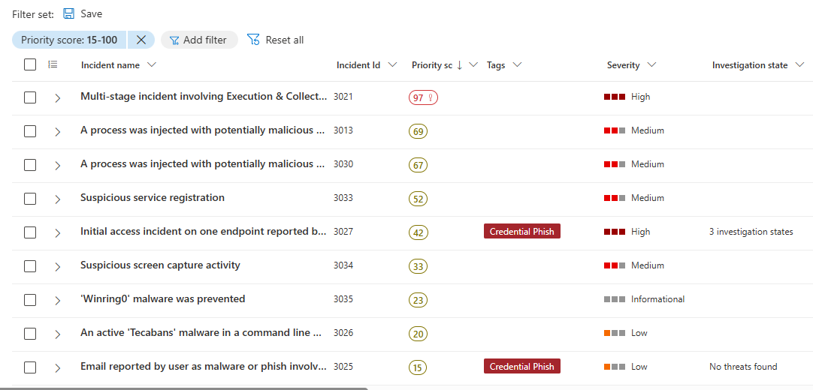

### Microsoft defender
Availability varies by Defender product, subscription, license, permissions, and whether devices are onboarded. 

You can use Defender not only to protect computers, but also to demonstrate cybersecurity skills, investigate incidents, automate security tasks, and build a portfolio project.

### 1. Incident investigation and response
Investigate suspicious activity, review related alerts, examine device and user timelines, and determine whether an endpoint is compromised.
Useful for: investigating phishing, malware, suspicious PowerShell commands, and endpoint compromises.

### 2. Vulnerability Management
Find vulnerable applications, outdated software, security weaknesses, and devices that need remediation.
Useful for: prioritizing patching and producing reports that show your organization's security posture.

### 3. Endpoint investigation and Live Response
Depending on your license and device onboarding, investigate endpoint activity, collect files, run supported commands remotely, and isolate a compromised device from the network.
Useful for: responding to incidents without physically accessing a laptop.

### 4. Email and phishing investigation
If your organization has Defender for Office 365, investigate malicious emails, examine who received them, review URLs and attachments, and investigate phishing campaigns.
Useful for: reducing phishing risk across Microsoft 365.

### 5. Advanced Hunting with KQL
Query security telemetry to find suspicious processes, PowerShell activity, network connections, and other indicators of compromise.
Useful for: developing practical threat-hunting skills that you can demonstrate to recruiters.

### Explore:
1. Home
The security overview, recommendations, alerts, and other dashboard information. There are a lot of information on the dashboard.  
On the dashboad you can see Microsoft Secure Score. It is a measurement of how well your organization follows Microsoft's recommended security controls. It assigns points for eligible security improvements and compares your current score with the maximum available score. 
There is no universal legal requirement to achieve a specific Score. some example for some framework.
-ISO 27001 ~Helps identify technical controls to strengthen  
-SOC2 ~Can help implement some technical safeguards and collect supporting evidence
-Quebec Law25 ~Privacy governance and protection of personal information
-Government ~contract requirements Contract-specific security standards and controls.  

2. Incidents & alerts
See detected threats and investigate what happened, which devices were affected, and what actions were taken.  

  
Review the incident summary, severity, affected assets, alerts, and evidence.
Open manage case. Look for an Export, Download, or reporting option, if available in your portal.

3. Assets → Devices
Check which computers Defender, their onboarding status, risk level, and security information. There are a lot of useful information to find vulnerability on the hardware of the company. 
  

4. Hunting → Advanced hunting
Advanced hunting in Microsoft Defender lets you investigate security events across your organization's devices, users, emails, and other Microsoft security data using Kusto Query Language (KQL). more details see [Advanced Hunting Templates](./Advanced-hunting-template/)

