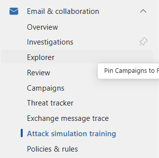

### Security training and Attack simulation
Microsoft Defender provides two useful features to improve our organization's cybersecurity awareness: security training campaigns and attack simulations.

-Go on defender
-Show navigation

### Training template:  

Training assignment notification

<strong>${firstName} ${lastName},</strong>

As part of our ongoing commitment to protecting company information and reducing cybersecurity risks, you have been assigned mandatory security awareness training by the <strong>Cyber Security Team</strong>.

You have been assigned training that will take approximately <strong>${trainingDuration} minute(s)</strong> to complete.

Please complete your assigned training by <strong>${trainingDueDate}</strong>.

<a href="https://security.microsoft.com/{{TrainingUrl}}" target="_blank" rel="noopener noreferrer">
    <strong>Go to My Training</strong>
</a>

The training is designed to help you recognize and respond to common cyber threats, including phishing emails, malicious links, social engineering attempts, and other security risks that could impact both you and our organization.

<strong>Training is mandatory for all assigned users.</strong> If you are unable to complete the training immediately, you may use the attached calendar invitation (.ics) to schedule dedicated time on your calendar.

Employees should charge time spent completing training to their normal charge code.

<strong>Assigned Training Details</strong>

${trainingDetails}

If you experience any issues accessing or completing your assigned training, or if you have any questions regarding this assignment, please contact the Cyber Security Team at
<a href="mailto:cybersecurity@iCompany.com">cybersecurity@iCompany.com</a>.

Thank you for helping keep iCompany secure.

Sincerely, 
<strong>icompany Cyber Security Team</strong>

Training reminder notification  

<strong>${firstName} ${lastName},</strong>

As part of our ongoing commitment to protecting company information and reducing cybersecurity risks, you have been assigned mandatory security awareness training by the <strong>InVeris Training Solutions Cyber Security Team</strong>.

You have been assigned training that will take approximately <strong>${trainingDuration} minute(s)</strong> to complete.

Please complete your assigned training by <strong>${trainingDueDate}</strong>.

<a href="https://security.microsoft.com/{{TrainingUrl}}" target="_blank" rel="noopener noreferrer">
    <strong>Go to My Training</strong>
</a>

The training is designed to help you recognize and respond to common cyber threats, including phishing emails, malicious links, social engineering attempts, and other security risks that could impact both you and our organization.

<strong>Training is mandatory for all assigned users.</strong> If you are unable to complete the training immediately, you may use the attached calendar invitation (.ics) to schedule dedicated time on your calendar.

Employees should charge time spent completing training to their normal charge code.

<strong>Assigned Training Details</strong>

${trainingDetails}

If you experience any issues accessing or completing your assigned training, or if you have any questions regarding this assignment, please contact the Cyber Security Team at
<a href="mailto:cybersecurity@inveristraining.com">cybersecurity@inveristraining.com</a>.

Thank you for helping keep InVeris Training Solutions secure.

Sincerely, 
<strong>InVeris Training Solutions Cyber Security Team</strong>

